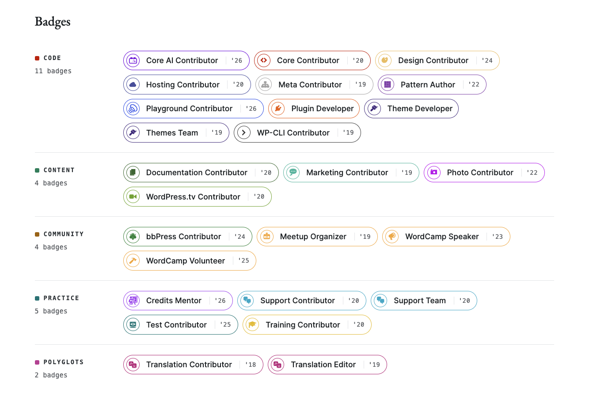

# Hi, I'm Fahim Murshid 👋

**WordPress Developer | Core Contributor | Themes Team Representative | Full-Stack Developer | AI Solutions Specialist**

I'm a WordPress developer, open-source contributor, and technical support professional from Bangladesh. I've been building websites and working with WordPress since 2008, helping businesses, agencies, and individuals build reliable digital experiences.

I specialize in WordPress development, custom themes and plugins, WooCommerce, website performance, security, technical support, and AI-powered web solutions. I also work with modern web technologies including React, Next.js, Node.js, Astro, PostgreSQL, and Cloudflare.

I'm passionate about open source, sharing knowledge, contributing to WordPress, and helping grow the developer community in Bangladesh.

### 🚀 What I Do

- 🖥️ WordPress Development, Custom Themes & Plugins
- 🛒 WooCommerce Development & E-commerce Solutions
- 🤖 AI Integration & AI-powered Web Applications
- ⚛️ React.js, Next.js & Full-Stack Development
- ⚡ Website Performance Optimization & Core Web Vitals
- 🔐 WordPress Security, Malware Cleanup & Website Recovery
- 🛠️ Technical Support, Troubleshooting & Product Support Engineering
- 🌐 Website Maintenance, Hosting & Cloud Infrastructure

### 🌍 WordPress Contributions

I'm an active contributor to the WordPress open-source ecosystem.

- 🏅 **WordPress Core Contributor**
- 🎖️ **WordPress.org Themes Team Representative, 2026**
- 🎨 Themes Team Member since November 2019
- 🔍 WordPress Theme Reviewer
- 🧩 WordPress Plugin & Theme Developer
- 📚 Documentation Contributor
- 🌐 Translation Contributor & Translation Editor
- 🖥️ Hosting, Meta, Support, Test, Training, Photos, Patterns, Playground and other contributor teams
- 👥 WordPress Meetup Organizer
- 🎤 WordCamp Speaker, Volunteer & Contributor Day Table Lead

I enjoy reviewing themes, contributing code, translating WordPress into Bengali, helping users in support forums, mentoring contributors, and making WordPress better for everyone.

### 👥 WordPress Community

- **WordCamp Barishal 2026:** Lead Organizer
- **WordCamp Dhaka 2025:** Volunteer, Support Table Lead & Themes Table Lead
- **WordCamp Sylhet 2024:** Support Table Lead
- **WordCamp Sylhet 2023:** Speaker
- **WordCamp Asia 2023:** Volunteer
- **WordCamp Kolkata 2022:** Attendee
- **WordCamp Taiwan Online 2021:** Attendee
- **WordCamp Italia Online 2021:** Attendee
- **WordCamp Spain Online 2021:** Attendee
- **WordCamp Europe Online 2020:** Attendee
- **WordCamp Dhaka 2019:** Attendee
- **WordCamp Kolkata 2019:** Attendee

I also lead the Barishal WordPress Meetup, where I help bring together WordPress developers, designers, freelancers, business owners, and enthusiasts to learn, share, and grow.

### 💻 Technologies & Tools

**WordPress:** Core, Gutenberg, Block Themes, FSE, WooCommerce, PHP

**Frontend:** HTML5, CSS3, JavaScript, React.js, Next.js, Astro

**Backend:** PHP, Node.js, REST API, PostgreSQL

**AI:** AI integrations, automation, AI-powered applications, LLM workflows

**Infrastructure:** Cloudflare, Linux, Docker, Web Hosting, DNS, CDN

**Tools:** Git, GitHub, VS Code, Figma

### 💼 Professional Experience

- **Product Support Lead** | Kahf | 2024–2026
- **Technical Support Specialist** | Brainstorm Force (Astra) | 2020–2024
- **Support Engineer** | Themeum, JoomShaper & Ollyo | 2016–2020
- **WordPress Developer & Freelancer** | 2011–Present

My experience spans product support engineering, WordPress development, technical troubleshooting, customer success, team leadership, product quality, and community engagement.

### 🏆 Recognition & Achievements

- WordPress.org Themes Team Representative, 2026
- WordPress Core Contributor
- Theme Reviewer since 2019
- Yoast Care Fund Recipient, 2021
- Contributor to WordPress 6.7
- WordCamp Speaker
- WordPress Meetup Organizer
- Open-source Plugin & Theme Developer

### 📫 Connect With Me

- 🌐 Website: [fmmurshidalam.com](https://fmmurshidalam.com/)
- 💼 LinkedIn: [linkedin.com/in/fmmurshid](https://www.linkedin.com/in/fmmurshid/)
- 🐙 GitHub: [github.com/murshed](https://github.com/murshed)
- 🌍 WordPress.org: [profiles.wordpress.org/fahimmurshed](https://profiles.wordpress.org/fahimmurshed/)
- 📘 Facebook: [fb.com/gFahim](https://fb.com/gFahim)
- 🐦 X: [@WPFahim](https://x.com/WPFahim)

💬 Feel free to reach out about WordPress, open source, web development, AI, community initiatives, collaboration, or anything interesting!

---

### 🌱 Open Source & Community

The places where I spend my time and actively contribute are captured in my contribution history. These are the communities and projects where I enjoy engaging, collaborating, and making a difference.

